# Course Companion — End-to-End Flow

This document traces how a request moves through the system: **frontend → backend → RAG service → data stores**, plus every fallback and background path. Diagrams are Mermaid; open this file in a Mermaid-capable viewer (GitHub, VS Code with the Mermaid extension, or the Mermaid Live Editor) to render them.

---

## 1. System overview

Three independently deployed services. The **frontend never talks to the RAG service**, and the **RAG service never talks to the frontend** — the backend is the only bridge, and it authenticates to the RAG service with a shared service key.

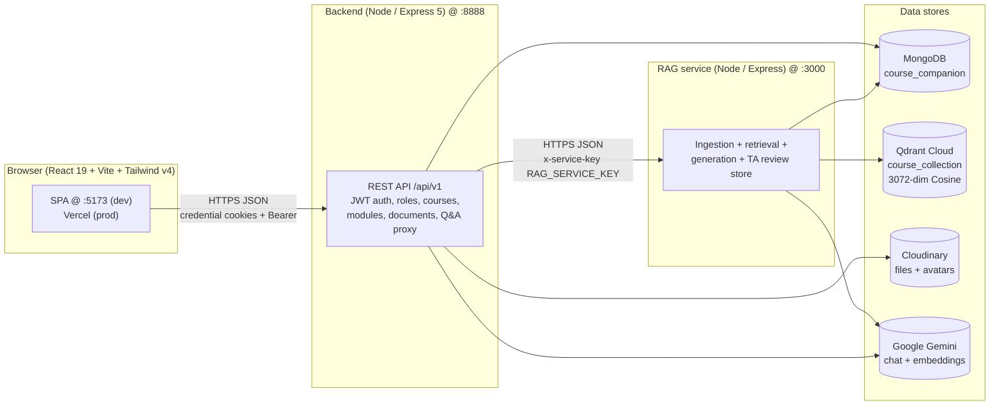

Key facts:

| Service | Port (dev) | Talks to | Auth |
|---|---|---|---|
| frontend | 5173 | backend only | access cookie + `Authorization: Bearer` |
| backend | 8888 | MongoDB, Cloudinary, RAG service, Gemini (key validation ping) | JWT (`ACCESS_TOKEN_SECRET`) + `roleGuard` |
| rag | 3000 | MongoDB (same DB), Qdrant, Gemini | `x-service-key: RAG_SERVICE_KEY` on every route except `/health` |

- Backend and RAG share the **same MongoDB** (`MONGODB_URI` + `DB_NAME`). The backend stores `Course`/`Module`/`Document`/`Question`/`Answer`/`User`; the RAG service owns `ReviewQueueItem`.
- Qdrant Cloud holds all vectors server-side, so the RAG service is **stateless** — a redeploy loses nothing local.

---

## 2. Authentication & session lifecycle

### 2.1 Signup → email verify → login

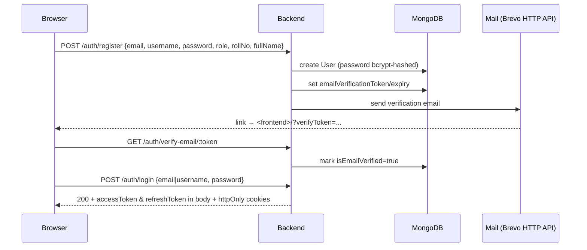

- Login accepts **either** an email or a username (`api/client.js` branches on `@`).
- `isEmailVerified` gates login; unverified logins get a 403 and the UI offers "resend verification".
- Post-signup the app shows a **role tour** (`Showcase.jsx`), then a "check your email" notice on the login screen.

### 2.2 Token refresh (dual-channel auth)

Cross-site cookies (Vercel → Railway) are dropped by some browsers even with `SameSite=None; Secure`, so the frontend keeps **in-memory tokens as a second channel** and attaches `Authorization: Bearer` on every call (`api/client.js`).

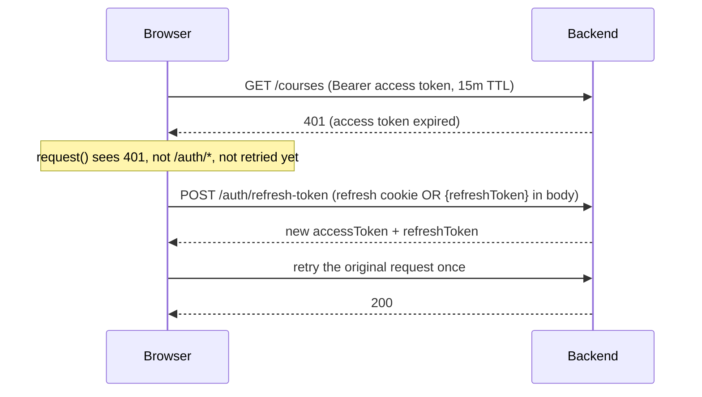

- On a **cold reload** past the 15-minute access window, `App.jsx restoreSession()` does one explicit `refreshAccessToken()` then `getCurrentUser()`, so an idle reload doesn't dump the user at sign-in.
- Direct file links (`<a target=_blank>`) can carry no header, so `getDocumentFileUrl()` appends `?token=<accessToken>`; `authGuard` reads cookie → header → `?token=` in that order.
- An 8-second fail-safe in `restoreSession()` flips to `anonymous` if the backend hangs.

### 2.3 Forgot / reset password

`POST /auth/forgot-password` → email link `<frontend>/?resetToken=...` → `App.jsx` reads the query param, shows `ResetPassword`, scrubs the token from the address bar with `history.replaceState`. Reset/verify screens take priority over an active session so the link always works.

---

## 3. Course setup & material ingestion (instructor/admin)

```mermaid
sequenceDiagram
  participant I as Instructor (browser)
  participant B as Backend
  participant DB as MongoDB
  participant C as Cloudinary
  participant R as RAG service
  participant Q as Qdrant
  participant G as Gemini

  I->>B: POST /courses {title}
  B->>DB: create Course + unique 5-digit joinCode + slug
  I->>B: POST /modules {title, course}
  B->>DB: create Module (order)
  I->>B: POST /documents/module/:moduleId (multipart PDF/TXT)
  B->>C: upload file (durable; ephemeral disk abandoned)
  C-->>B: secure_url + public_id
  B->>DB: create Document {url, cloudinaryPublicId, type, fileSizeBytes}
  B->>R: POST /ingest {documentId, moduleId, courseId, filename, fileBase64, user_key}
  R->>R: extract → hash → chunk → embed
  R->>G: embed chunks + caption figures + overview
  R->>Q: addDocuments(chunks)
  R-->>B: {skipped, chunksIngested, contentHash, overview}
  B->>DB: Document.isIndexed=true, overview, contentHash (or indexingError)
  B-->>I: 201 Document uploaded
```

Notes:

- `INDEXABLE_TYPES = {pdf, article}` (`document.controller.js`). Other types (video/image/slides/link/other) are stored and downloadable but never indexed — there is no extraction path for them yet.
- Ingestion is **awaited** (not fire-and-forget) so the upload response can honestly report indexing status; but a RAG failure never fails the upload — the file/record are already saved and `indexingError` is stored for later retry.
- The upload's **overview + figure captions** are funded by the uploader's own Gemini key when healthy (BYOK), otherwise the shared pool. Metered on supply.

### 3.1 Ingestion pipeline (inside `rag/ingest-logic.js`)

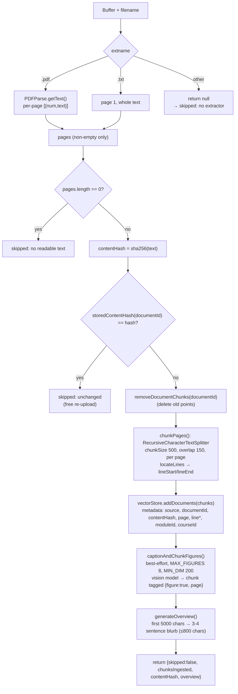

- **Idempotency:** the sha256 of extracted text is the key. Re-uploading identical content short-circuits before any embedding call. Changed content removes the old points first (no duplicates).
- **Citations are real:** each chunk records `source`, `page`, `lineStart`, `lineEnd` from `locateLines()`, so answers stay traceable to a location. Line numbers are approximate (chunk overlap); page numbers are exact.
- **Figures:** text extractors are blind to diagrams/charts/equations. Embedded images ≥200px (up to 8) are captioned by the vision-capable chat model (formulas transcribed) and ingested as ordinary retrievable chunks.
- **Embeddings:** `gemini-embedding-001` → **3072-dim**. Query-time and ingest-time embedders **must match**; `EMBEDDING_DIM = 3072` is fixed when the Qdrant collection is created, so switching models means a new collection.

### 3.2 Join-code enrollment

- Every course gets a unique **5-digit numeric** `joinCode` (leading zeros preserved, retried on collision).
- `POST /courses/join {code}` adds the caller to `students` or `tas` **based on their own account role** — there is no separate student vs TA code.
- Joining an unpublished course is refused with guidance (students only see published courses).
- `assertCourseAccess()` (used by every course-scoped controller) allows: any `admin`, the course's own instructor, and joined students/TAs. Instructors never see another instructor's courses (strict ownership). The list endpoints (`getAllCourses`, `getMyModules`) and the quiz feed share the same rule via `accessibleCourseFilter()`, so lists can't drift from the access checks.

---

## 4. Student asks a question

`POST /qa/ask` (backend) → `POST /submit-question` (RAG). The backend derives `courseId` **server-side from the module**, never trusting the client, and enforces membership first.

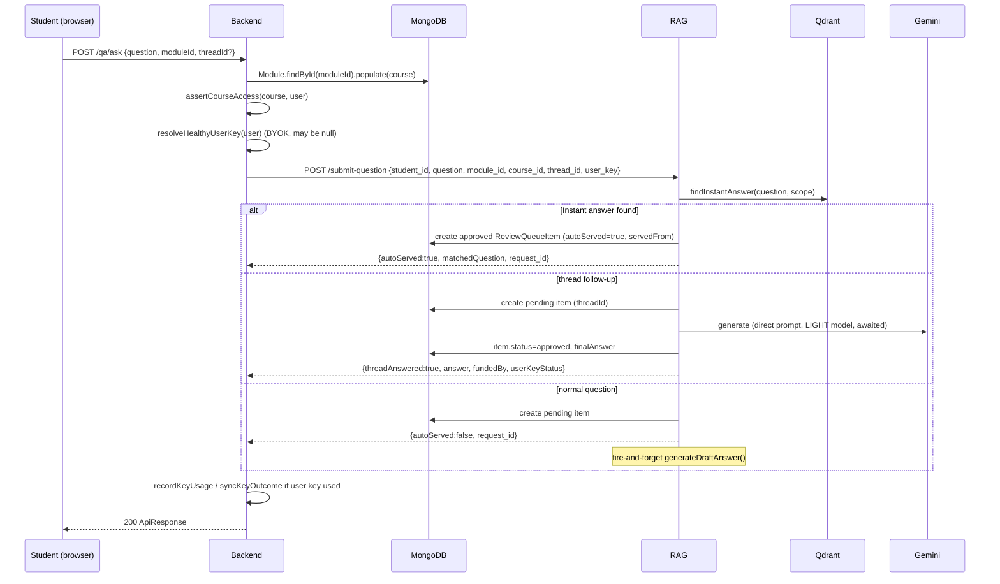

Three distinct outcomes, cheapest path first:

1. **Instant answer (no TA):** the question matches a previously TA-approved answer closely enough to serve immediately.
2. **Thread follow-up (no TA):** answered synchronously with the relaxed prompt, served approved straight away.
3. **Normal queue:** saved as `pending`, generation runs in the background, a TA reviews before anything reaches the student.

### 4.1 Instant-answer fast path (`findInstantAnswer`)

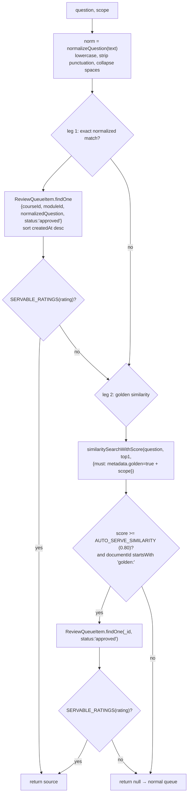

- `AUTO_SERVE_SIMILARITY = 0.80` (`rag/services/retrieval.js`) was calibrated on real golden answers: genuine paraphrases score **0.84–0.98**, unrelated same-scope questions top out at **0.70** — 0.80 sits in the clean gap (was 0.90, which effectively disabled the similarity leg).
- `SERVABLE_RATINGS`: only `null`/`undefined` (unrated) or **≥ 3 stars** may serve or teach. 1–2★ approvals are quarantined.
- The auto-served item is a **per-student clone** (`autoServed:true`, `servedFrom:<sourceId>`) so their history/stats read naturally; it never enters the TA queue and is never re-ingested as golden (avoids golden-of-golden cloning).
- The `matchedQuestion` is returned so the UI can show *which* verified question answered them ("Answered instantly from a verified answer to: …").

### 4.2 Retrieval + generation (`generateDraftAnswer`)

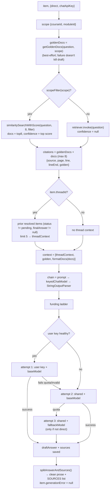

Funding ladder detail:

- **baseModel** = `PRIMARY_MODEL` (`gemini-3.6-flash`) for normal questions; `LIGHT_MODEL` for direct follow-ups (threads need speed/quota headroom).
- Ladder: `[user key + base]` → `[shared + base]` → `[shared + fallback]` (third rung only for non-direct). Duplicate rungs are dropped.
- Only **quota-shaped** failures advance the ladder; other errors stop it (replaying a bad request just burns quota twice).
- On success, `fundedBy` (`user`/`shared`) and `userKeyStatus` are returned for metering; user-key successes clear the health map entry.
- On total failure, `generationError` + `generationAttempts` are stored **on the item**, so the queue surfaces it with a **Retry** button instead of hiding it forever.

### 4.3 Live "related answers" while typing

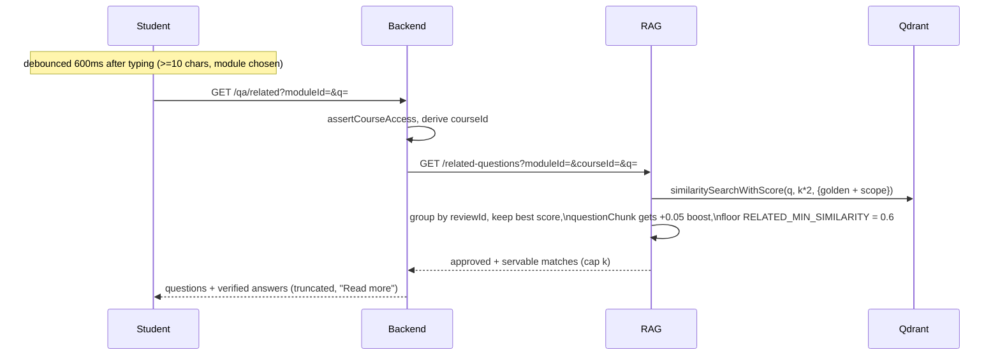

- Students can **save** a related answer into their history (`/qa/save` → `/save-answer`, clone marked `autoServed`) or **unsave** it (`/qa/unsave` → `/unsave-answer`, only own auto-served clones).
- Scope must match exactly (same course + module) and rating must be servable, or the save 4xxs.

---

## 5. TA review flow

`GET /qa/queue` (backend) fetches all pending items from RAG and **re-sorts shakiest-first** (lowest retrieval `confidence` first, unknown last, then oldest). TAs only see modules in courses they've joined (admins see all).

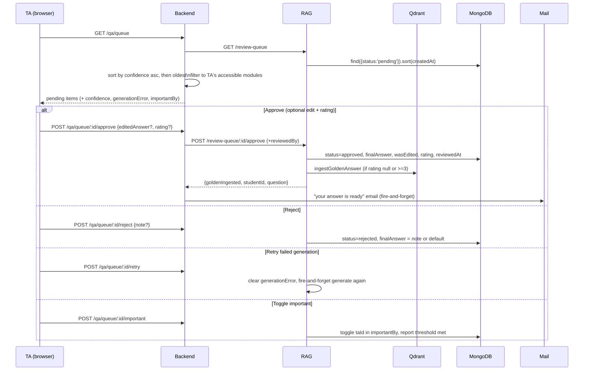

### 5.1 The feedback loop — approved answers teach the pipeline

`ingestGoldenAnswer` re-embeds a TA-approved answer as **"golden"** chunks:

- Answer text split 500/150 **plus** a `Question: <text>` chunk (so question-to-question related search works, not just question-to-answer).
- Keyed as `documentId = golden:<reviewId>` with remove-then-add, so re-approving never duplicates.
- Carries the question's `courseId`/`moduleId` scope and the TA's `rating` (numeric).
- Golden chunks are placed **ahead of raw material** in the next draft's context, so a correction wins over the document that produced the original mistake.

Policy: only `null` (unrated) or **≥ 3★** approvals teach (`GOLDEN_MIN_RATING = 3`). 1–2★ answers are kept out so poor drafts can't self-perpetuate.

### 5.2 Important marks → instructor portal

Each TA has a **checkbox** per question; `importantBy` stores distinct TA ids. When marks reach the course's own `importantThreshold` (default 2 = two different TAs flagged it; set by an admin on the course's Modules page), the question is highlighted to the instructor. The backend forwards the bar to RAG as `?threshold=`; `GET /qa/important?courseId=` returns non-rejected items meeting it, hottest first, with no cap on how many highlight.

---

## 6. Threads (follow-up chatbot)

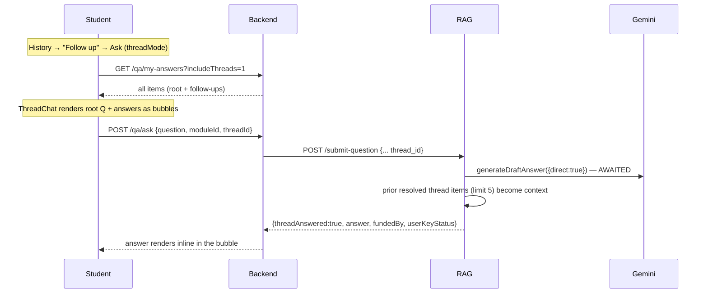

- Follow-ups **skip the TA queue entirely** — the answer generates synchronously (student waits seconds) and is served approved immediately. Unreviewed answers never teach, so no golden ingest for these.
- Thread items are hidden from the History page by default (`filter.threadId = null`) and shown in `ThreadChat`; stats include them.
- The thread's resolved Q&A history is injected as context so "what about France then?" inherits everything established above without restating.

---

## 7. Instructor analytics portal

`AdminModules` (per course) calls two RAG-backed endpoints and joins user names in the backend:

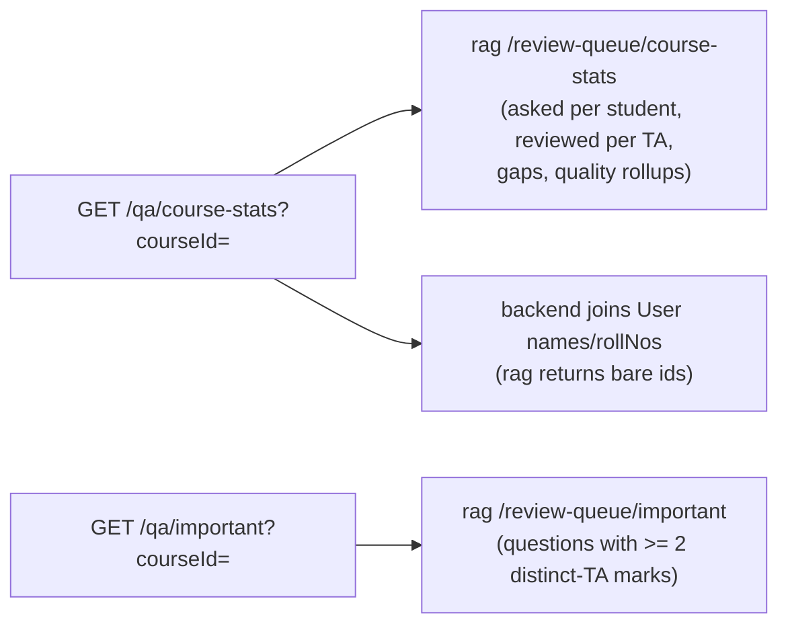

- **Answer quality:** avg TA rating, how many were improved vs approved as-is, approved/rejected/pending counts, mean resolution hours.
- **Content gaps:** per-module count of drafts whose answer is exactly `"I don't know."` — aggregated, that's the instructor's curriculum radar (topics students asked about that the material couldn't answer).
- A RAG outage degrades these sections to empty instead of failing the page.

---

## 8. Deletion & cascade semantics

### 8.1 Delete a document

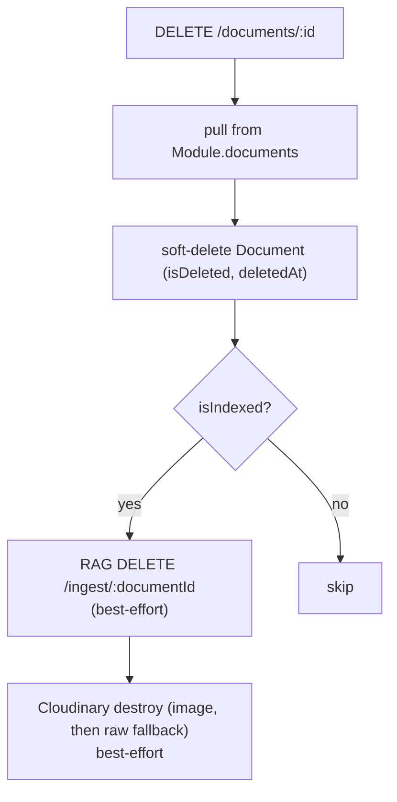

### 8.2 Delete a course (hard cascade)

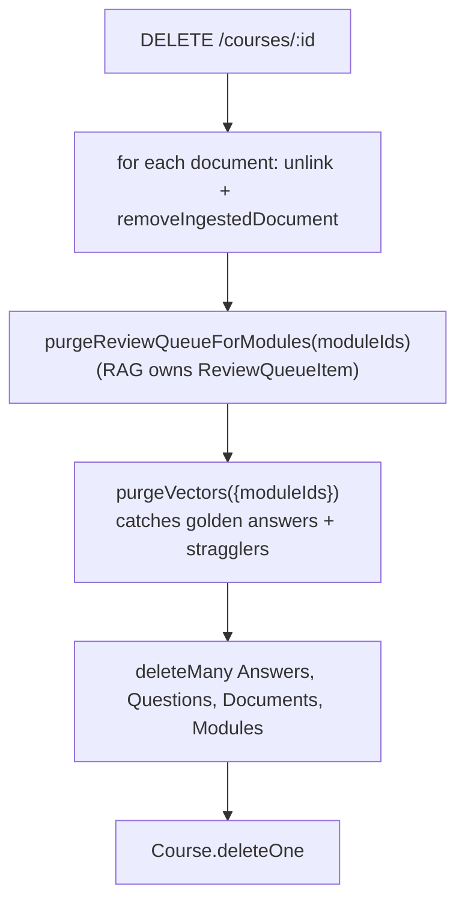

Every cascade step is **best-effort** — one unreachable service never blocks the delete; stale data is retried on a later pass.

### 8.3 Remove a member

`DELETE /courses/:id/members/:userId` pulls the id from `students`/`tas`, then calls `purgeMemberHistory(studentId, moduleIds)` — scoped to that one student so everyone else's history survives.

---

## 9. BYOK (bring-your-own Gemini key)

### 9.1 Key vault

`backend/src/utils/keyvault.js` — **AES-256-GCM**, blob format `iv:authTag:ciphertext` (all base64). Requires `GEMINI_KEY_SECRET` (64 hex chars); missing/malformed fails loud at first use.

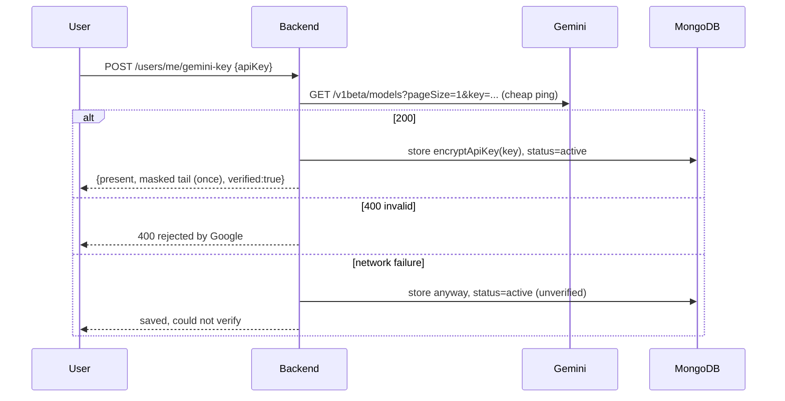

- Plaintext exists **only** in function arguments and the decrypted return; it is never returned, logged, or stored.
- `GET /users/me/gemini-key` returns only `{present, masked, status, cooldownUntil, usageToday}`.

### 9.2 Health, cooldown, metering

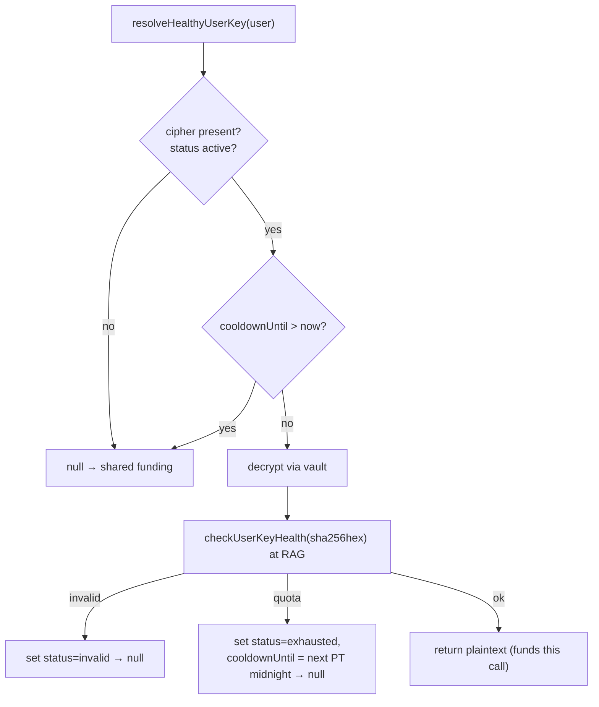

- The RAG service keeps a per-key health map keyed by **sha256 of the key** (never the key): `quota` cools until next Pacific midnight; `invalid` parks until the key changes.
- Metering is **approximate** (on supply, not confirmed success — Google exposes no per-key quota API). `geminiKeyUsageCount` resets on the day boundary.
- Dashboard nudge: if the shared pool is strained **and** the student has no key, `Ask.jsx` shows "add your free Gemini key to keep going".
- TAs are excluded from key UI entirely (their keys would fund nothing).

---

## 10. RAG service route map

```mermaid
flowchart LR
  subgraph Gate["service-key gate (except /health)"]
    H["GET /health\npublic liveness + sharedQuota"]
    I["POST /ingest"]
    IP["POST /ingest/purge"]
    ID["DELETE /ingest/:documentId"]
    UK["GET /user-key-health?hash="]
    SQ["POST /submit-question"]
    RQ["GET /review-queue"]
    RR["POST /review-queue/:id/retry"]
    RP["POST /review-queue/purge"]
    RPM["POST /review-queue/purge-member"]
    MH["GET /module-history/:moduleId"]
    AP["POST /review-queue/:id/approve"]
    RJ["POST /review-queue/:id/reject"]
    IM["POST /review-queue/:id/important"]
    RQL["GET /related-questions"]
    SA["POST /save-answer"]
    UA["POST /unsave-answer"]
    IQ["GET /review-queue/important"]
    CS["GET /review-queue/course-stats"]
    MA["GET /my-answer/:id"]
    MAS["GET /my-answers/:studentId"]
    ST["GET /stats/:studentId"]
  end
```

Backend `rag.service.js` proxies each with `x-service-key`, strips a trailing slash from `RAG_SERVICE_URL`, and translates an HTML error page (asleep/crashed service) into a readable "RAG service unavailable — may be waking from sleep" message.

---

## 11. Data model & indexes

### 11.1 Backend MongoDB (Mongoose)

| Model | Key fields | Notes |
|---|---|---|
| `User` | role, username, email, fullName, rollNo, avatar, password, isEmailVerified, refreshToken, emailVerificationToken, forgotPasswordToken, `geminiApiKeyCipher`, `geminiKeyStatus`, `geminiKeyCooldownUntil`, `geminiKeyUsageDate/Count` | bcrypt password; `AvailableUserRoles` = admin, instructor, ta, student |
| `Course` | title, slug (unique), description, tags, instructor, joinCode (5-digit unique), students[], tas[], modules[], isPublished, importantThreshold (default 2, min 1), isDeleted, deletedAt | soft-delete hook on `find` |
| `Module` | title, description, course, order, documents[], questions[], isPublished, isDeleted | soft-delete |
| `Document` | title, module, type (pdf/video/article/slides/link/other), fileSizeBytes (≤50MB), url, cloudinaryPublicId, isIndexed, indexingError, contentHash, overview | soft-delete |
| `Question` | module, text, type, answers[], order, points, explanation, isDeleted | |
| `Answer` | question, text, isCorrect, status (draft/reviewed/published), reviewedBy/At, publishedBy/At, order, isDeleted | `answer-workflow.service.js` `VALID_TRANSITIONS` |
| `ReviewQueueItem` (RAG-owned) | studentId, moduleId, courseId, question, normalizedQuestion, draftAnswer, sources, status, finalAnswer, rating, confidence, generationError/Attempts, wasEdited, threadId, importantBy[], autoServed, servedFrom, reviewedBy/At, citations[] | index `{studentId, createdAt:-1}` |

### 11.2 Qdrant points

- **Material chunks:** `{source, documentId, contentHash, page, lineStart, lineEnd, moduleId, courseId, figure?}`
- **Golden chunks:** `{source:"TA-verified answer", documentId:"golden:<reviewId>", golden:true, question, rating?, moduleId, courseId, questionChunk?}`
- **Payload indexes** (`ensureQdrantCollection`): keyword on `metadata.documentId`, `metadata.moduleId`, `metadata.courseId`; **bool** on `metadata.golden`, `metadata.seeded` (this Qdrant version 400s on bool `match` filters without a bool index).

---

## 12. Configuration

| Var | Service | Purpose |
|---|---|---|
| `MONGODB_URI`, `DB_NAME` | backend, rag | shared cluster; RAG appends `DB_NAME` |
| `ACCESS_TOKEN_SECRET`, `REFRESH_TOKEN_SECRET` | backend | JWT signing |
| `CORS_ORIGIN` | backend | comma-separated allowed origins |
| `CLOUDINARY_*` | backend | file + avatar storage |
| `GEMINI_KEY_SECRET` | backend | 64-hex AES-256-GCM vault key |
| `RAG_SERVICE_URL`, `RAG_SERVICE_KEY` | backend | bridge to RAG |
| `RAG_SERVICE_KEY` | rag | must match backend |
| `GEMINI_API_KEY` | rag | shared pool chat + embeddings |
| `GEMINI_MODEL` / `GEMINI_FALLBACK_MODEL` / `GEMINI_LIGHT_MODEL` | rag | primary/fallback/light model selection |
| `QDRANT_URL`, `QDRANT_API_KEY`, `QDRANT_COLLECTION` | rag | vector store |
| `PORT` | rag | default 3000 |

---

## 13. Failure & fallback matrix

| Failure | Behaviour |
|---|---|
| RAG service unreachable | Backend names it ("may be waking from sleep"); uploads still succeed with `indexingError`; analytics degrade to empty |
| Golden retrieval fails mid-draft | Continues with plain scoped retrieval (never kills the draft) |
| Overview/figure caption fails | Ingest still succeeds; document just has no blurb |
| Instant-answer lookup fails | Falls through to the normal queue |
| User key quota/invalid | Ladder drops to shared primary, then shared fallback |
| Generation fails entirely | Item stays pending with `generationError` + Retry in the queue |
| Access token expired | One silent refresh + retry; else 401 |
| Backend hangs on reload | 8-second fail-safe → anonymous |
| Course/module/document delete cascade | Every cross-service step best-effort; delete never blocked |
